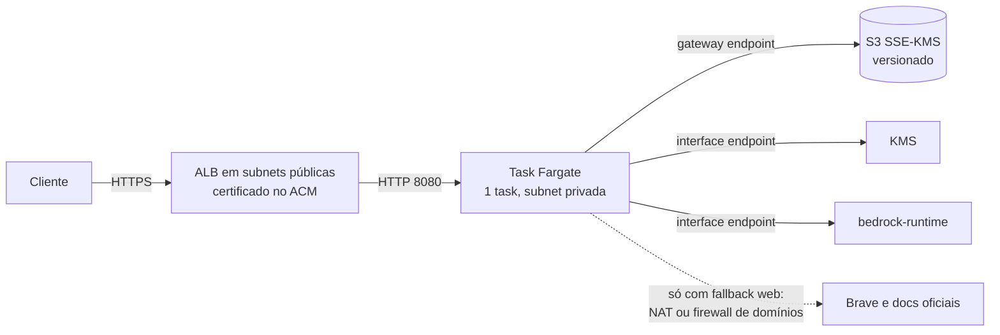

# Deploy na AWS

Este documento descreve como colocar o Sage no ECS Fargate com o acervo no S3 cifrado pelo KMS e as perguntas respondidas pelo Bedrock. Uma ressalva antes de tudo: este guia não foi aplicado numa conta AWS. Os recursos e as políticas abaixo foram escritos a partir das chamadas que o código faz (listadas em cada seção) e da documentação dos serviços; revise nomes, ARNs e regiões antes de usar, e teste num ambiente sem dados reais primeiro. A parte local, com Docker, está no [README](../README.md).

O desenho tem uma peça só: uma task Fargate, atrás de um Application Load Balancer, falando com S3, KMS e Bedrock por VPC endpoints.



## Por que uma task só

O Sage guarda na memória do processo o índice de busca, o catálogo de documentos, o cache de respostas, as conversas, os baldes de rate limit e os jobs de importação. Duas tasks atrás do mesmo balanceador funcionariam, mas com o limite de requisições multiplicado, continuações de conversa caindo na task errada e uploads visíveis só na task que os recebeu até a outra reiniciar (a lista completa está em [seguranca.md](seguranca.md#o-que-não-está-coberto)). Por isso o serviço roda com `desiredCount` 1.

Isso tem um custo de disponibilidade que convém aceitar de olhos abertos. Numa troca de versão, o ECS normalmente sobe a task nova antes de parar a antiga, e por alguns minutos teríamos duas. Com `minimumHealthyPercent` 0 e `maximumPercent` 100 o ECS para a antiga primeiro: não há duas instâncias, mas há uma janela sem serviço, do tamanho do tempo de subida (puxar a imagem, carregar os modelos e indexar o acervo; durante a carga do índice o health check responde 503). Para o porte previsto, uma equipe interna, trocar disponibilidade por simplicidade é uma escolha razoável. Quando isso deixar de valer, o caminho é tirar o estado de dentro do processo, e não só aumentar o `desiredCount`.

## Tamanho da task e da imagem

Os três modelos ONNX (embeddings, reranker e NLI) somam uns 2,1 GB em disco e levam o processo a cerca de 3,7 GB de memória residente, medidos num teste com os três carregados. A memória fora da heap, a dos modelos, não entra no `-Xmx`, e a heap precisa de espaço próprio para o índice Lucene e os vetores. O mínimo é 4 GB de memória na task; para um acervo de dezenas de MB, 8 GB dão folga. No Fargate, 2 vCPU aceitam de 4 a 16 GB e 1 vCPU aceita de 2 a 8 GB, mas a CPU também pesa: o reranker e o NLI rodam na CPU, e os tempos de [decisoes.md](decisoes.md#calibração-com-as-perguntas-gabarito) foram medidos em 16 processadores lógicos. Com 2 vCPU espere os tempos maiores e medi-los com `-Peval` na própria configuração antes de confiar nos 200 ms.

A JVM em contêiner usa por padrão 25% da memória da task como heap máxima. Com 8 GB são 2 GB, o que sobra bem para um acervo pequeno e deixa o resto para os modelos. Não suba a porcentagem sem medir: o que a heap ganha, os modelos perdem, e o kernel mata a task por falta de memória durante o primeiro lote de reranking, não na subida.

A imagem é grande porque os modelos vão dentro dela (o build baixa e confere o sha256 de cada um). Isso simplifica o deploy, sem bucket de modelos e sem download na partida, e cobra o preço no primeiro pull da imagem pela task: alguns GB, o que no Fargate leva minutos. Use `SAGE_GUARD_REQUIRE_NLI=true`, que a imagem já define: se o modelo de NLI sumir, a task não sobe, em vez de responder sem verificar fundamentação.

Configure o health check do target group em `/actuator/health` (código 200) e dê ao serviço um `healthCheckGracePeriodSeconds` de pelo menos 300: a carga do índice acontece depois do `ApplicationReadyEvent`, e até lá o endpoint responde 503. Um acervo maior precisa de mais tempo (veja a estimativa em [arquitetura.md](arquitetura.md#carga-inicial-e-saúde)).

Fargate não tem tmpfs. A imagem foi pensada para rodar com o sistema de arquivos raiz somente leitura (`readonlyRootFilesystem: true`), e o que precisa de escrita é só `/tmp` (cache do tokenizer em `/tmp/djl`). Monte um volume efêmero em `/tmp`. As bibliotecas nativas do ONNX Runtime e do tokenizer já estão extraídas em `/app/native`, então nada é executado a partir de `/tmp`.

## Chave KMS

Uma chave simétrica de criptografia (`SYMMETRIC_DEFAULT`) com rotação anual automática ligada. O Sage faz três chamadas a ela: `GenerateDataKey` (AES_256, uma por documento novo), `Decrypt` (uma por leitura de blob) e `DescribeKey` (uma vez, na subida, para falhar cedo se a chave ou a permissão estiverem erradas).

A política da chave é o que realmente implementa o "só o agente lê". Em vez da declaração padrão que entrega a conta inteira à política do IAM, a política abaixo nomeia quem pode o quê: a role da task usa a chave e não a administra, e uma role de administração a administra e não a usa.

```json
{
  "Version": "2012-10-17",
  "Statement": [
    {
      "Sid": "TaskUsaAChave",
      "Effect": "Allow",
      "Principal": { "AWS": "arn:aws:iam::111122223333:role/sage-task" },
      "Action": ["kms:Decrypt", "kms:GenerateDataKey", "kms:DescribeKey"],
      "Resource": "*"
    },
    {
      "Sid": "AdminAdministraMasNaoUsa",
      "Effect": "Allow",
      "Principal": { "AWS": "arn:aws:iam::111122223333:role/sage-kms-admin" },
      "Action": [
        "kms:Create*", "kms:Describe*", "kms:Enable*", "kms:List*", "kms:Put*",
        "kms:Update*", "kms:Revoke*", "kms:Disable*", "kms:Get*", "kms:Delete*",
        "kms:TagResource", "kms:UntagResource", "kms:ScheduleKeyDeletion", "kms:CancelKeyDeletion"
      ],
      "Resource": "*"
    }
  ]
}
```

Antes de apertar, uma recomendação de ordem: comece pela política padrão da AWS, com a declaração que habilita o IAM da conta (`Principal` raiz da conta, `kms:*`), mais a role da task como usuária da chave. Com ela, qualquer administrador da conta ainda consegue consertar um erro. Só depois que tudo funcionar, e com um plano para o caso de bloqueio, troque pela política acima. O trade-off está no que a política omite: sem a declaração que habilita o IAM da conta, nenhuma política de usuário ou role, nem a do administrador da conta, concede acesso à chave. Se a role `sage-kms-admin` for apagada, a chave fica sem administrador, e recuperar o acesso passa pelo suporte da AWS. Decida isso conscientemente; a alternativa mais branda é manter a declaração padrão para sempre e trocar a garantia por uma regra de SCP ou por um alarme no CloudTrail sobre `kms:Decrypt` fora da role da task. Habilitar a exclusão com janela de 30 dias e nunca agendá-la sem cópia da decisão é parte do trato: apagar a chave torna o acervo irrecuperável.

Se o bucket usa SSE-KMS com a mesma chave (próxima seção), o S3 chama o KMS em nome de quem fez o pedido, então a role da task precisa dessas mesmas permissões, e a política acima já as dá. Usar duas chaves, uma para o envelope do Sage e outra para o SSE-KMS do bucket, separaria os alvos de um incidente, ao custo de mais uma política para manter.

## Bucket S3

O Sage grava e lê blobs que já chegam cifrados, e pede SSE-KMS em cada escrita. O SSE-KMS do bucket é uma segunda camada, e a razão para tê-la é de governança: a política da chave vira o controle de acesso do bucket inteiro, e o CloudTrail registra cada uso da chave. O bucket precisa existir antes (a aplicação não o cria) e deve ter:

- Block Public Access ligado nas quatro opções, no bucket e na conta.
- Versionamento ligado. Cada substituição de documento (`substituir=true`) mantém a versão anterior; o preço é que apagar um documento deixa as versões antigas, cifradas, no bucket, e remover de verdade exige uma regra de ciclo de vida para versões não correntes (por exemplo, expirar em 90 dias) ou uma exclusão explícita por versão.
- Criptografia padrão SSE-KMS com a chave acima e S3 Bucket Key ligado. Sem o Bucket Key, cada PUT e GET vira uma chamada ao KMS, o que soma custo e latência.
- Uma política que recusa tráfego sem TLS e escrita que peça outro tipo de criptografia que não SSE-KMS. Operadores negados (`StringNotEquals`) casam quando a chave de condição está ausente, então a política nega toda escrita que não traga o cabeçalho `x-amz-server-side-encryption: aws:kms`. É por isso que o `S3BlobStorage` manda `ServerSideEncryption=aws:kms` em cada `PutObject` (com a chave padrão do bucket, a do passo anterior); sem isso a política bloquearia o próprio Sage. Há um teste de integração com LocalStack que confere o cabeçalho no objeto gravado.
- Uma regra de ciclo de vida para abortar uploads multipart incompletos e expirar versões não correntes.

```json
{
  "Version": "2012-10-17",
  "Statement": [
    {
      "Sid": "SoTLS",
      "Effect": "Deny",
      "Principal": "*",
      "Action": "s3:*",
      "Resource": [
        "arn:aws:s3:::sage-acervo-111122223333",
        "arn:aws:s3:::sage-acervo-111122223333/*"
      ],
      "Condition": { "Bool": { "aws:SecureTransport": "false" } }
    },
    {
      "Sid": "NegaOutraCriptografia",
      "Effect": "Deny",
      "Principal": "*",
      "Action": "s3:PutObject",
      "Resource": "arn:aws:s3:::sage-acervo-111122223333/*",
      "Condition": { "StringNotEquals": { "s3:x-amz-server-side-encryption": "aws:kms" } }
    }
  ]
}
```

O Sage usa quatro operações no S3: `ListObjectsV2` (a carga inicial e a poda de lacunas), `GetObject`, `PutObject` e `DeleteObject`. A task role não precisa de mais nada: nem `GetObjectVersion`, nem `PutBucketPolicy`.

## VPC endpoints

A task fica em subnet privada, sem IP público. O tráfego para os três serviços de que ela depende não precisa sair pela internet:

| Serviço | Tipo de endpoint | Observação |
| --- | --- | --- |
| S3 | Gateway (grátis) | Anexe uma política de endpoint que só permita o bucket do Sage. Sem isso, o endpoint deixa a task falar com qualquer bucket. |
| KMS | Interface (`com.amazonaws.<região>.kms`) | DNS privado ligado. |
| Bedrock | Interface (`com.amazonaws.<região>.bedrock-runtime`) | DNS privado ligado. É o endpoint de inferência; o do plano de controle (`bedrock`) não é usado. |

Endpoints de interface cobram por hora e por zona de disponibilidade, além do dado trafegado. Com uma task só, uma subnet em uma AZ basta para o Sage; o ALB pede ao menos duas.

Para puxar a imagem do ECR e mandar logs ao CloudWatch sem passar pela internet, a task também precisaria dos endpoints `ecr.api`, `ecr.dkr` e `logs`. Quem já tem um NAT para o fallback web pode usá-lo para isso e economizar os endpoints.

## Saída para a internet (fallback web)

Sem `SAGE_BRAVE_API_KEY`, o fallback web fica desligado e o Sage não precisa de saída nenhuma além dos endpoints: este é o modo mais fechado, e o recomendado até alguém precisar do fallback. A importação por URL (`POST /api/importar`) também baixa páginas, e fica sem efeito sem saída para a internet.

Com a chave, a task precisa falar em HTTPS (443) com `api.search.brave.com` e com os domínios da allowlist (`docs.oracle.com`, `openjdk.org`, `docs.spring.io` por padrão). Um security group só filtra por IP e porta, não por nome, então a opção simples é um NAT gateway com saída 443 aberta, e a trava de domínio fica só no código. Esse é o limite real da simplicidade: o `AllowlistedPageFetcher` recusa host fora da allowlist, IP privado e redirect para fora, mas uma falha nele não encontraria uma segunda barreira na rede. A defesa em profundidade é um AWS Network Firewall (ou um proxy de saída) com a lista de domínios, mais caro e com mais peças para operar. Escolha conforme o quanto o fallback importa; a alternativa honesta é deixá-lo desligado.

## Bedrock

Habilite o acesso aos dois modelos (rápido e forte) na região escolhida e use os ids, ou os inference profiles, em `SAGE_MODEL_FAST_ID` e `SAGE_MODEL_STRONG_ID`. O Sage usa a Converse API em streaming, que a IAM trata como `bedrock:InvokeModelWithResponseStream`.

O model invocation logging precisa estar desligado. Quando ligado, o Bedrock grava prompt e resposta num bucket ou no CloudWatch, e o prompt é exatamente o que o Sage faz de tudo para não deixar em claro em lugar nenhum: trechos do acervo, inclusive de documentação interna. Isso é uma configuração da conta e da região, não do Sage, e o código não consegue verificá-la. Confira com `aws bedrock get-model-invocation-logging-configuration` (a resposta deve vir sem configuração) e considere uma política de controle de serviço que negue `bedrock:PutModelInvocationLoggingConfiguration` a todos fora de uma role de administração.

Um inference profile entre regiões pode processar o prompt em outra região do conjunto. Se a residência dos dados importar, use um id de modelo da região da task, ou um profile cujo conjunto de regiões seja aceitável, e lembre que a política IAM da task precisa listar o ARN do profile e os ARNs dos modelos em todas as regiões dele.

## Política IAM da task

A role da task é a única identidade que usa a chave e os dados. Ela precisa de S3, KMS e Bedrock, e de mais nada. A role de execução (a que o ECS usa para puxar a imagem, gravar logs e ler segredos) é outra, e leva as políticas gerenciadas padrão do ECS.

```json
{
  "Version": "2012-10-17",
  "Statement": [
    {
      "Sid": "ListaOBucket",
      "Effect": "Allow",
      "Action": "s3:ListBucket",
      "Resource": "arn:aws:s3:::sage-acervo-111122223333"
    },
    {
      "Sid": "BlobsDoAcervo",
      "Effect": "Allow",
      "Action": ["s3:GetObject", "s3:PutObject", "s3:DeleteObject"],
      "Resource": "arn:aws:s3:::sage-acervo-111122223333/*"
    },
    {
      "Sid": "ChaveDoAcervo",
      "Effect": "Allow",
      "Action": ["kms:Decrypt", "kms:GenerateDataKey", "kms:DescribeKey"],
      "Resource": "arn:aws:kms:us-east-1:111122223333:key/00000000-0000-0000-0000-000000000000"
    },
    {
      "Sid": "ModelosDoBedrock",
      "Effect": "Allow",
      "Action": ["bedrock:InvokeModel", "bedrock:InvokeModelWithResponseStream"],
      "Resource": [
        "arn:aws:bedrock:us-east-1::foundation-model/<id-do-modelo-rapido>",
        "arn:aws:bedrock:us-east-1::foundation-model/<id-do-modelo-forte>"
      ]
    }
  ]
}
```

Os ARNs dos modelos mudam conforme você use o id direto ou um inference profile (nesse caso, acrescente o ARN `arn:aws:bedrock:<região>:<conta>:inference-profile/<id>` e os modelos de cada região do profile). O `kms:DescribeKey` pode parecer dispensável, mas a subida o chama de propósito: sem ele a aplicação não sobe com `provider=kms`.

## Variáveis e segredos

No task definition, o conjunto mínimo:

```json
{
  "environment": [
    { "name": "SAGE_CRYPTO_PROVIDER", "value": "kms" },
    { "name": "SAGE_KMS_KEY_ID", "value": "alias/sage-acervo" },
    { "name": "SAGE_STORAGE_TYPE", "value": "s3" },
    { "name": "SAGE_S3_BUCKET", "value": "sage-acervo-111122223333" },
    { "name": "SAGE_MODEL_FAST_ID", "value": "<id-do-modelo-rapido>" },
    { "name": "SAGE_MODEL_STRONG_ID", "value": "<id-do-modelo-forte>" },
    { "name": "AWS_REGION", "value": "us-east-1" },
    { "name": "SAGE_GUARD_REQUIRE_NLI", "value": "true" },
    { "name": "SAGE_AUTH_KEYS_0_NAME", "value": "painel" },
    { "name": "SAGE_AUTH_KEYS_0_ROLE", "value": "READER" }
  ],
  "secrets": [
    { "name": "SAGE_AUTH_KEYS_0_SHA256", "valueFrom": "arn:aws:secretsmanager:us-east-1:111122223333:secret:sage/painel-hash" },
    { "name": "SAGE_BRAVE_API_KEY", "valueFrom": "arn:aws:secretsmanager:us-east-1:111122223333:secret:sage/brave" }
  ]
}
```

O hash da chave de API não é segredo no mesmo sentido da chave (ele não autentica sozinho), e pô-lo no Secrets Manager é só para não deixá-lo versionado num arquivo de task definition. A chave da API em si nunca passa por aqui: gere-a com `scripts/new-api-key`, entregue ao cliente e guarde só o hash. Todas as variáveis estão descritas, com padrão e efeito, em [configuracao.md](configuracao.md). O Sage tem uma variável a menos do que parece para a região: o cliente do S3 e o do KMS leem `AWS_REGION` da cadeia padrão da AWS, e o do Bedrock a recebe de `spring.ai.bedrock.aws.region`, que o `application.yml` liga ao mesmo `AWS_REGION`.

Logs: o driver `awslogs` para o CloudWatch serve, porque o Sage só registra ids, hashes, tempos, rota e modelo. Mesmo assim defina um prazo de retenção.

## Ordem de montagem

Chave KMS e as duas roles; bucket com a política e o ciclo de vida; endpoints; repositório ECR e push da imagem (`docker build -t sage-agent .`); task definition e serviço com `desiredCount` 1; ALB com certificado do ACM e o target group em `/actuator/health`; por fim, a primeira chave de API e o primeiro upload. O TLS termina no ALB, e o Sage fala HTTP na 8080 dentro da VPC: configure o listener para repassar `X-Forwarded-Proto`, porque o cabeçalho `Strict-Transport-Security` só é emitido quando a aplicação vê a requisição como HTTPS.

## O que este guia não cobre

Alta disponibilidade (a task única é uma escolha, não um descuido), autoescalonamento, WAF na frente do ALB, backup e recuperação de desastre do bucket (o versionamento protege contra apagar e sobrescrever, não contra perder a conta ou a chave), alarmes, e a migração entre os providers `local` e `kms`, que não existe.

## Rodando localmente com Docker

O `docker-compose.yml` monta `./data` em `/app/data` e roda como o usuário 10001, sem privilégios, com o sistema de arquivos somente leitura. No Docker Desktop (Windows e macOS) isso funciona sem ajuste. Num host Linux, o diretório montado pertence ao seu usuário, e o contêiner, que roda como 10001, não consegue gravar nele: crie o diretório antes e passe a posse, com `mkdir -p data && sudo chown 10001:10001 data`, ou use um volume nomeado. O compose monta `./secrets` em `/app/secrets` (somente leitura), e o arquivo da chave local também precisa ser legível pelo uid 10001. Sem isso o sintoma é a aplicação falhando na subida, antes de qualquer pergunta, com a mensagem sobre a chave mestra.
