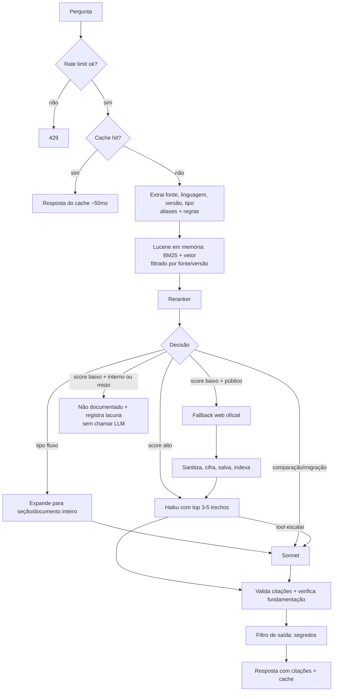

# Sage-Agent — Design

Data: 2026-10-27 · Status: para aprovação · Repositório: `E:\Code\Sage-Agent` → `https://github.com/RennAraujo/Sage-Agent.git`

## 1. Intenção

Hoje, ao perguntar algo sobre documentação de uma linguagem, o agente pesquisa na internet a cada pergunta: lento, caro, não escala. O Sage-Agent inverte a ordem. A documentação é enviada (upload) para um acervo criptografado que só o agente consegue ler; o agente responde a partir desse acervo e só vai à web quando a versão pedida de uma linguagem pública não está lá. Quando vai, salva o que encontrou, organizado e criptografado, para a próxima pergunta igual ser rápida.

Além de tirar dúvidas pontuais, o agente explica fluxos de funcionamento da aplicação da empresa quando a documentação os descreve.

Público: começa com a equipe (todos veem toda a documentação), deve poder expandir para clientes depois. Uso: integrado a uma aplicação da empresa; mini chat próprio para testes. Hospedagem: AWS. Prioridades: segurança (sem vazamento, sem delírio), depois velocidade e custo.

## 2. Objetivos

- Upload de documentação pelo mini chat e pela API.
- Todo o acervo criptografado em repouso; conteúdo legível apenas pelo processo do agente.
- Responder sobre **duas fontes**:
  - **Linguagens/frameworks públicos** (Java, Spring, etc.), por versão.
  - **Documentação da aplicação da empresa**, incluindo explicação de fluxos.
- Resposta baseada somente no conteúdo do acervo, sempre com citação.
- Fallback na web **só para fontes públicas**, resultado salvo criptografado no acervo.
- Haiku por padrão, Sonnet quando necessário, cache para perguntas repetidas.
- Mini chat para testar, com painel de diagnóstico.
- Tudo dockerizado; código limpo; documentação do projeto completa e escrita por gente para gente.

## 3. Não-objetivos (por agora)

- Jev ou qualquer modelo de decisão de terceiros.
- Multi-cliente / isolamento por cliente (o modelo de dados deixa espaço, não implementa).
- Permissões por módulo (todos veem tudo).
- Integração final na aplicação da empresa (o agente expõe a API; integrar é etapa seguinte).
- Visualização ou download do conteúdo bruto dos documentos por humanos via API.

## 4. Anti-objetivos (falha mesmo se "funcionar")

- Qualquer trecho do acervo em texto puro fora da memória do processo: disco, logs, git, cache persistente, mensagens de erro.
- Qualquer documento ou chave indo para o repositório do GitHub.
- Termo da documentação interna enviado para busca na web.
- Responder sem citar fonte, ou inventar quando a documentação não cobre (delírio).
- Seguir instruções escondidas dentro de um documento ou página web (prompt injection).
- Primeiro texto da resposta acima de ~1,5 s para perguntas respondidas pelo acervo.

## 5. Stack

- **Java 25 (LTS)** + **Spring Boot 4.x** (última estável), **Maven**.
- **Spring AI** para Bedrock (Converse API), tool calling e streaming.
- **Claude via Amazon Bedrock**: Haiku (padrão) e Sonnet (escalada). Inferência cross-region permitida.
- **Apache Lucene** in-process, **em memória**: BM25 + busca vetorial (HNSW).
- **ONNX Runtime Java** para embeddings, reranker e verificador de fundamentação (CPU).
- **Apache Tika** para converter uploads (PDF, DOCX, HTML) em Markdown.
- **AWS KMS** para as chaves; **S3** para o acervo criptografado.
- **Docker** (Dockerfile multi-stage + docker-compose).

## 6. Acervo de documentação

### 6.1 Organização lógica

O formato continua sendo o do Obsidian: Markdown com frontmatter. O Obsidian vira a ferramenta de **escrita** (com um template pronto no repositório); depois de escrito, o documento é enviado por upload e passa a existir só criptografado.

```
publico/<linguagem>/<versao>/<slug>.md
interno/<aplicacao>/<slug>.md
```

Frontmatter:

```yaml
fonte: publico | interno
linguagem: java            # ou nome da aplicação (interno)
versao: "25"               # opcional para interno
secao: "Stream API"
aliases: [jdk25, java 25]  # opcional; alimenta a extração de linguagem/versão
url_origem: https://...    # só públicos
coletado_em: 2026-10-27
revisado: true | false     # false quando veio do fallback web
```

Uploads sem frontmatter recebem os campos informados no formulário de upload (fonte, linguagem/aplicação, versão).

### 6.2 Criptografia

- **Envelope encryption**: cada documento é cifrado com uma chave de dados própria (AES-256-GCM); a chave de dados é cifrada pela chave mestra no KMS e guardada junto do arquivo.
- **Só o agente lê**: na AWS, apenas a IAM role do container tem `kms:Decrypt` na chave mestra. Quem acessa o bucket S3 vê só blobs cifrados. Bucket com bloqueio de acesso público, SSE-KMS, versionamento e TLS obrigatório.
- **Local (desenvolvimento)**: provedor de chave local (arquivo de chave fora do repositório, montado no container). A interface `KeyProvider` troca KMS por local sem mudar o resto.
- **Índice em memória**: o Lucene roda em `ByteBuffersDirectory`. Na subida, o agente decifra o acervo e monta o índice na RAM; nada indexado vai para o disco. Para o volume de uma equipe, isso cabe com folga e leva segundos.
- **Cache, conversas e lacunas**: cache e histórico de conversa só em memória, com TTL. `_lacunas` (perguntas internas sem resposta) e auditoria são gravadas cifradas, como o acervo.
- **Logs**: nunca registram conteúdo de documento, prompt ou resposta. Registram ids, hashes, tempos, modelo e caminho percorrido.

### 6.3 Upload

- `POST /api/documentos` (multipart), papel `editor`.
- Formatos: `.md`, `.txt`, `.pdf`, `.docx`, `.html` (convertidos para Markdown via Tika). Upload em lote via `.zip` de uma pasta do Obsidian.
- Validações: tamanho máximo por arquivo e por lote, tipo detectado pelo conteúdo (não pela extensão), proteção contra zip bomb e path traversal, frontmatter obrigatório completo.
- **Varredura de segredos** antes de cifrar: se o documento contiver padrões de chave de API, token, senha ou chave privada, o upload é recusado com a linha apontada, para o editor limpar e reenviar.
- Mesmo caminho = substitui (versão anterior mantida pelo versionamento do S3). Exclusão por `DELETE /api/documentos/{id}`.
- Editores veem **metadados** (caminho, seção, versão, revisado, data); não há endpoint que devolva o conteúdo. Páginas `revisado: false` são aprovadas ou excluídas por metadados.

## 7. Fluxo de uma pergunta



1. **Rate limit** por API key (evita extração em massa do acervo por perguntas em série).
2. **Cache** exato em memória: pergunta normalizada + fonte + versão. Só vale para a primeira pergunta de uma conversa.
3. **Extração**: linguagem/versão por regex sobre aliases (tabela pública versionada no repositório + aliases tirados do frontmatter dos documentos). Sem versão → mais recente do acervo, dita na resposta. Continuação de conversa herda linguagem/versão. **Tipo** por regras: `consulta`, `fluxo` ("como funciona", "qual o fluxo", "passo a passo"), `comparacao` (duas versões, "diferença", "migrar").
4. **Busca híbrida** + **reranker**; o score decide o caminho. Limiares em configuração.
5. **Explicação de fluxos**: o trecho encontrado é expandido para a seção inteira (ou documento, se pequeno) e para os documentos que ele referencia por wiki-link. Sonnet monta a explicação passo a passo, cita cada passo e, se a documentação descrever as etapas, gera diagrama Mermaid. Se a documentação não detalha o fluxo, diz isso em vez de completar.
6. **Escalada**: Haiku tem a tool `escalar`; regras diretas mandam `fluxo` e `comparacao` ao Sonnet.
7. **Interno sem resposta ou pergunta mista**: nunca vai à web. Sem trecho acima do limiar, responde "não encontrei isso na documentação" **sem chamar LLM** e registra a lacuna.
8. **Fallback web** (só público): ver seção 9.
9. **Resposta**: streaming SSE com citações e metadados.

## 8. Segurança

### 8.1 Contra vazamento

- Criptografia e "só o agente lê": seção 6.2.
- **Repositório**: `.gitignore` bloqueia acervo, chaves, `.env`, índices e modelos; `gitleaks` no CI e como hook de pre-commit.
- **Bedrock**: acesso por VPC endpoint (PrivateLink), sem trafegar pela internet; model invocation logging desligado; credenciais por IAM role, nunca chave estática. Bedrock não guarda nem treina com os prompts.
- **Autenticação**: API key por pessoa, com papéis `leitor` e `editor`; chaves guardadas como hash; comparação em tempo constante.
- **Auditoria cifrada**: quem perguntou, quando, quais documentos foram citados, quem subiu/excluiu o quê.
- **Filtro de saída**: a resposta passa por detector de segredos antes de sair.
- **Erros**: respostas de erro padronizadas (RFC 9457 `ProblemDetail`), sem stack trace nem conteúdo.
- **Container**: imagem mínima, usuário não-root, sistema de arquivos somente leitura (exceto tmp), sem shell no runtime; Trivy no CI.
- **Mini chat**: Content-Security-Policy restrita, sem scripts de terceiros, saída renderizada como texto/Markdown sanitizado.

### 8.2 Contra delírio e prompt injection

- **Sem contexto, sem LLM**: se nenhum trecho passa do limiar, a resposta padrão é dada pelo código.
- **Prompt de sistema estrito**: responder só com os trechos fornecidos; dizer quando não há informação; temperatura 0.
- **Trechos tratados como dados**: entram delimitados e marcados como conteúdo não confiável; o prompt instrui a ignorar instruções contidas neles. Páginas web passam por sanitização (remoção de scripts, HTML oculto, texto invisível) antes de salvar.
- **Citação obrigatória e validada**: cada afirmação cita `[n]`; o código confere que toda citação aponta para um trecho realmente enviado. Resposta sem citação válida é refeita uma vez e, se falhar de novo, substituída pela resposta padrão.
- **Verificação de fundamentação**: modelo NLI pequeno (ONNX, CPU) confere se as frases da resposta são sustentadas pelos trechos citados; frases não sustentadas são removidas ou a resposta é marcada como incerta.
- **Ferramentas mínimas**: o modelo só tem a tool `escalar`. Não acessa URLs, não lê arquivos, não executa nada.
- **Transparência**: a resposta mostra versão usada e marca fontes `revisado: false` como "fonte não revisada".
- **Testes de segurança** no conjunto-gabarito: perguntas fora do acervo, documentos com injeção plantada, tentativas de extrair o acervo inteiro.

## 9. Fallback web

- Dispara para fonte pública quando a versão não existe no acervo ou quando o score fica abaixo do limiar.
- Consulta construída só com linguagem, versão e termos técnicos públicos; nunca com texto de documento interno.
- Busca restrita a uma allowlist de domínios oficiais por linguagem (ex.: `docs.oracle.com`, `docs.spring.io`), via API de busca com filtro `site:` (Brave Search ou Tavily).
- Página baixada, sanitizada, convertida para Markdown, cifrada e salva em `publico/<linguagem>/<versao>/<slug>.md` com `revisado: false`; indexada em memória na hora. Limite de páginas por pergunta.

## 10. API e mini chat

- `POST /api/perguntas` — SSE: texto + metadados (modelo, caminho, score, citações, latência por etapa). Aceita `conversaId`.
- `POST /api/documentos`, `GET /api/documentos` (metadados), `PATCH /api/documentos/{id}` (aprovar revisão), `DELETE /api/documentos/{id}`.
- `GET /api/lacunas` (editor).
- `POST /api/importar` (editor) — semeia o acervo a partir de uma URL raiz da allowlist, profundidade limitada.
- **Mini chat** em `/chat`: HTML + JS puro servido pelo Spring Boot. Pergunta com streaming, aba de upload, lista de documentos (metadados) e painel de diagnóstico por resposta.

## 11. Docker e AWS

- **Local**: `docker compose up`; acervo cifrado em volume; chave local montada como secret; credenciais AWS por perfil.
- **AWS**: ECS Fargate (uma instância no MVP), acervo no S3 com KMS, VPC endpoints para S3/KMS/Bedrock, IAM role mínima (S3 do bucket, `kms:Decrypt`/`GenerateDataKey` da chave, `bedrock:InvokeModel*` dos dois modelos). Sem Lambda.

## 12. Padrões de código

- **Arquitetura hexagonal (ports & adapters)**, organizada por funcionalidade: o núcleo (pergunta, decisão de caminho, resposta, documento) não conhece Bedrock, Lucene, S3 nem KMS; cada um entra por uma interface (`LanguageModel`, `SearchIndex`, `DocumentStore`, `KeyProvider`, `WebSearch`). Trocar Haiku por outro modelo, ou plugar o Jev no futuro, é escrever um adapter.
- **Clean code**: classes e métodos pequenos com uma responsabilidade; nomes que dizem o que a coisa faz; sem números mágicos (limiares e limites em `@ConfigurationProperties` validadas); injeção por construtor; `record` e imutabilidade para dados; sem `null` nas fronteiras (`Optional` ou objeto vazio); exceções de domínio tratadas num `@ControllerAdvice` único; comentários só onde o *porquê* não é óbvio.
- **Idioma**: código (classes, métodos, variáveis) em inglês; documentação, mensagens de commit e textos para o usuário em português.
- **Qualidade automática**: Spotless (formatação), Checkstyle, SpotBugs, JaCoCo (cobertura), testes JUnit 5 + AssertJ + Mockito; Bedrock e busca web simulados com WireMock nos testes de integração.
- **Arquivos-base desde o primeiro commit**: `.gitignore`, `.gitattributes` (fim de linha LF, essencial no Windows), `.editorconfig`.

`.gitignore` cobre, no mínimo: `target/`, arquivos de IDE (`.idea/`, `.vscode/`, `*.iml`), `.env*` (exceto `.env.example`), `secrets/`, `*.key`, `*.pem`, `data/` (acervo e auditoria locais), `models/` (ONNX baixados no build/subida, não versionados), logs, `.obsidian/` e arquivos do SO.

## 13. Critérios de sucesso

- Cache hit < 100 ms; pergunta respondida pelo acervo com primeiro texto < 1,5 s; pipeline antes do LLM < 200 ms.
- ≥ 80% das perguntas resolvidas pelo Haiku.
- 100% das respostas com citação válida; 0 respostas inventadas no conjunto de perguntas fora do acervo.
- 0 documentos com injeção plantada que alterem o comportamento.
- Nenhum texto do acervo encontrado em disco, logs ou repositório (teste automatizado procura trechos conhecidos).

## 14. Escolhas minhas (revisar)

- Obsidian como ferramenta de escrita; após upload o documento só existe cifrado. Isso substitui a ideia de sincronizar o acervo por git + Obsidian Git: com "só o agente lê", o acervo não pode ficar legível no git nem em pastas do Obsidian.
- Acervo no S3 + KMS; índice só em memória.
- Papéis `leitor` e `editor`; editores veem metadados, nunca conteúdo.
- Formatos de upload além de `.md` (PDF, DOCX, HTML, ZIP) via Tika.
- Upload com segredo detectado é recusado.
- Fallback web também quando o score é baixo; pergunta mista nunca vai à web.
- Conversa com continuação curta; cache só na primeira pergunta.
- Sem crawler em massa; semeadura via `importar`.
- Verificador NLI de fundamentação além da validação de citações.
- Maven; código em inglês.

## 15. Documentação do projeto (entregável)

| Arquivo | Conteúdo |
|---|---|
| `README.md` | O que é, o problema que resolve, como subir com Docker em poucos minutos, uma pergunta de exemplo com a resposta real, links para o resto. |
| `docs/arquitetura.md` | Componentes, portas e adapters, diagrama e como se conectam. |
| `docs/fluxo-de-uma-pergunta.md` | Uma pergunta real percorrida etapa por etapa, com tempos medidos; um exemplo para cada caminho (cache, Haiku, Sonnet, fluxo, web, interno não documentado). |
| `docs/acervo-e-upload.md` | Organização, frontmatter, template do Obsidian, upload, revisão de páginas da web, lacunas. |
| `docs/seguranca.md` | Modelo de ameaças, criptografia, chaves, o que nunca sai do processo, defesas contra vazamento, delírio e prompt injection, e o que *não* está coberto. |
| `docs/fallback-web.md` | Quando dispara, allowlist, sanitização, por que interno nunca vai à web. |
| `docs/api.md` | Contratos de todos os endpoints, eventos SSE, papéis. |
| `docs/configuracao.md` | Variáveis de ambiente e limiares, valor padrão e efeito de cada um. |
| `docs/deploy-aws.md` | ECS, S3, KMS, VPC endpoints, IAM mínima. |
| `docs/decisoes.md` | Cada decisão importante: contexto, opções, escolha, consequência. |
| `docs/design.md` | Este documento. |

Regras de escrita: texto direto, como um dev explicando para outro dev do time; frases de tamanhos variados; explicar o porquê e os trade-offs; exemplos e números tirados do sistema rodando; sem emoji, sem frases de efeito ("solução robusta", "vale ressaltar", "em resumo"), sem excesso de negrito, sem transformar tudo em lista; limitações escritas abertamente; termos técnicos no original.

A documentação cresce com o código: cada etapa atualiza o que afeta; a última revisa tudo.

## 16. Etapas de implementação (um commit por etapa)

Cada etapa é um commit próprio com código, testes e documentação da etapa. Conventional Commits em português. Todo commit compila, passa nos testes e no Spotless/Checkstyle. Commits locais; push para `origin/main` só com autorização.

| # | Commit | O que entrega |
|---|---|---|
| 1 | `chore: estrutura inicial do projeto` | `git init`, branch `main`, remote `origin`; `.gitignore`, `.gitattributes`, `.editorconfig`; Maven com Java 25 e Spring Boot 4; Spotless, Checkstyle, SpotBugs, JaCoCo; Dockerfile multi-stage não-root; docker-compose; `README.md` inicial; `docs/design.md`. |
| 2 | `ci: pipeline de build, testes e varredura de segurança` | GitHub Actions: build, testes, qualidade, gitleaks, Trivy, análise de dependências; hook de pre-commit com gitleaks. |
| 3 | `feat: criptografia em envelope com KMS e chave local` | `KeyProvider` (KMS e local), AES-256-GCM, testes garantindo que nada é gravado em claro. |
| 4 | `feat: armazenamento cifrado do acervo` | `DocumentStore` (S3 e sistema de arquivos local), metadados, versionamento. |
| 5 | `feat: autenticação por API key com papéis` | Leitor/editor, hash das chaves, rate limit, auditoria cifrada. |
| 6 | `feat: upload de documentação` | Endpoints de documentos, Tika, ZIP, validações, varredura de segredos, template do Obsidian, `docs/acervo-e-upload.md`. |
| 7 | `feat: índice Lucene em memória com BM25` | Decifra e indexa na subida, chunking por título, reindexação incremental após upload/exclusão. |
| 8 | `feat: embeddings multilíngues e busca híbrida` | ONNX na CPU, vetores no Lucene, combinação BM25 + vetor. |
| 9 | `feat: reranker` | Cross-encoder multilíngue ONNX, score exposto. |
| 10 | `feat: extração de fonte, linguagem, versão e tipo` | Aliases públicos + do frontmatter, regras de tipo, detecção de pergunta mista. |
| 11 | `feat: resposta com Haiku via Bedrock e streaming SSE` | `/api/perguntas`, prompt estrito, trechos delimitados, citação obrigatória e validada, resposta padrão sem contexto, `docs/api.md`. |
| 12 | `feat: escalada para Sonnet` | Tool `escalar`, regras de `comparacao`. |
| 13 | `feat: explicação de fluxos` | Expansão de contexto por seção e wiki-links, explicação passo a passo, Mermaid quando a documentação descreve as etapas. |
| 14 | `feat: cache e continuação de conversa` | Cache em memória com TTL, `conversaId`, herança de linguagem/versão. |
| 15 | `feat: lacunas da documentação interna` | Resposta "não encontrei", registro cifrado, `/api/lacunas`. |
| 16 | `feat: fallback web com allowlist` | Busca restrita, sanitização, conversão, gravação cifrada, `revisado: false`, `docs/fallback-web.md`. |
| 17 | `feat: semeadura do acervo por importação` | `/api/importar` com profundidade limitada. |
| 18 | `feat: verificação de fundamentação e filtro de saída` | NLI ONNX sobre a resposta, detector de segredos na saída. |
| 19 | `feat: mini chat de teste` | `/chat` com perguntas, upload, lista de documentos e painel de diagnóstico; CSP. |
| 20 | `test: perguntas-gabarito, latência e segurança` | ~30 perguntas por fonte, perguntas fora do acervo, documentos com injeção plantada, busca de texto em claro em disco/logs; relatório contra as metas. |
| 21 | `docs: documentação completa do projeto` | Revisão final de todos os arquivos da seção 15, com exemplos e tempos reais; `docs/seguranca.md` e `docs/decisoes.md` completos. |

## 17. Deixado para o builder

- Tamanho de chunk, limiares iniciais, texto do prompt de sistema.
- Modelos ONNX exatos (embeddings, reranker, NLI), desde que multilíngues e rodando em CPU dentro das metas de latência.
- Escolha entre Brave Search e Tavily.
- Estrutura interna de pacotes dentro das regras da seção 12.
